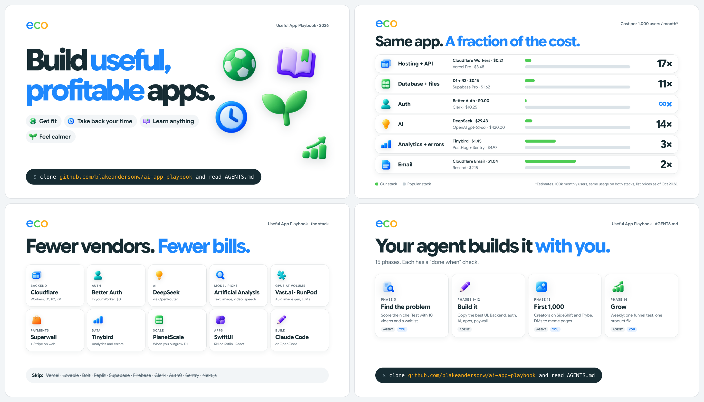

```
Clone https://github.com/blakeandersonw/ai-app-playbook and read AGENTS.md
```

Paste into Claude Code or OpenCode, in an empty folder.

Please [follow me](https://github.com/blakeandersonw) and star this repo to stay up to date!

[](https://github.com/blakeandersonw) [](https://github.com/blakeandersonw/ai-app-playbook)

<p align="center">
  
</p>

# How to build useful, profitable apps in 2026

My background: I've scaled 5 apps to $100k+ MRR in the past 3 years.

This is the stack I would start with today. We initially built [EcoGPT](https://ecogpt.com) ([apply here](https://ecogpt.com/careers/founding-engineer)) on this stack.

Good apps help people get fit, focus, learn, or feel calmer, and people pay for them. This playbook goes from picking a problem to your first profitable month.

## Examples

| Help people… | Like |
|---|---|
| 💪 Get fit and eat better | Cal AI, Ladder, Yuka |
| 📵 Take back their time | Opal, Structured |
| 📚 Learn | Duolingo, Speak, Photomath |
| 🧘 Feel calmer | Hallow, Finch |
| 🌱 Understand the world | PictureThis, Yuka |
| 💼 Earn | SideShift |

## The path

| Phase | What | Check |
|---|---|---|
| 0 · Niche | Pick a frequent problem AI solves in seconds. Test it with 10 videos and a waitlist | Score ≥ 25/35, real demand |
| 1–12 · Build | Brief, repo, backend, auth, AI, web, iOS/Android, payments, analytics, onboarding, retention, launch | "Done when" per phase |
| 13 · First 1,000 | Short-form video, creators on SideShift / Trybe, DMs to influencers and meme pages | Content live and tracked |
| 14 · Grow | Weekly: one funnel experiment, one product fix | Weekly report |

## The stack

| Job | Use |
|---|---|
| Backend, data, files, jobs, email | [Cloudflare](https://developers.cloudflare.com/workers/) (Workers, D1, R2, KV, Durable Objects, Queues, Workflows, AI Gateway) |
| Auth | [Better Auth](https://www.better-auth.com) |
| Database at scale | [PlanetScale](https://planetscale.com) |
| AI | [OpenRouter](https://openrouter.ai), DeepSeek by default. Pick models with [Artificial Analysis](https://artificialanalysis.ai) |
| Custom AI (ASR, image gen, self-hosted LLMs) | [Vast.ai](https://vast.ai) / [RunPod](https://www.runpod.io). Much cheaper at volume |
| Payments | [Superwall](https://superwall.com) (mobile), [Stripe](https://stripe.com) (web) |
| Analytics + errors | [Tinybird](https://www.tinybird.co) |
| Clients | SwiftUI for iOS, React Native or Kotlin for Android, React + Vite for web |
| Building | [Claude Code](https://claude.com/claude-code), or [OpenCode](https://opencode.ai) + DeepSeek |

**Don't use:** Vercel, Netlify, Lovable, Bolt, v0, Replit hosting, Bubble, FlutterFlow, Firebase, Supabase, Clerk, Auth0, Sentry, PostHog, Next.js, ORMs.

## The money (per month)

Benchmark estimate: 30% of downloads start a trial, 30% of trials pay $30/year. That's about $2.70 per download.

| | | | | |
|---|---|---|---|---|
| **Downloads** | 1,000 | 10,000 | 100,000 | 1,000,000 |
| **Revenue** | $2,700 | $27,000 | $270,000 | $2,700,000 |
| Superwall (1%) | $27 | $270 | $2,700 | $27,000 |
| Cloudflare | $5 | $20 | $190 | $2,300 |
| Tinybird | $0 | $50 | $275 | $2,500 |
| AI processing | $35 | $350 | $3,500 | $35,000 |

Details: [12 · Costs](playbook/12-costs.md).

## Our stack vs. the popular stack\*

Per 1,000 users per month.

| Job | Ours | Cost | Popular | Cost | Popular costs |
|---|---|---|---|---|---|
| Hosting + API | Cloudflare Workers | $0.21 | Vercel Pro | $3.48 | **~17×** |
| Database + files | D1 + R2 | $0.15 | Supabase Pro | $1.62 | **~11×** |
| Auth | Better Auth | $0 | Clerk | $10.25 | **∞×** |
| AI (60 calls/user) | DeepSeek | $29.43 | OpenAI `gpt-6.1-sol` | $420.00 | **~14×** |
| Analytics + errors | Tinybird | ~$1.45 | PostHog + Sentry | ~$4.97 | **~3×** |
| Email | Cloudflare Email | $1.04 | Resend | $2.15 | **~2×** |

\*Estimates at 100k monthly users, same usage, list prices as of Oct 26, 2026. [Sources](playbook/12-costs.md#our-stack-vs-the-popular-stack).

## Chapters

| # | Chapter | |
|---|---|---|
| 00 | [Find your niche](playbook/00-find-your-niche.md) | Patterns, scorecard, validation, domains |
| 01 | [Building with agents](playbook/01-building-with-agents.md) | Harnesses, building fast, what not to use |
| 02 | [Backend](playbook/02-backend-cloudflare.md) | One Worker, no framework |
| 03 | [Database](playbook/03-database.md) | D1 with plain SQL, then PlanetScale |
| 04 | [Auth](playbook/04-auth.md) | Better Auth, anonymous first |
| 05 | [AI](playbook/05-ai.md) | DeepSeek, Artificial Analysis, Vast.ai / RunPod |
| 06 | [Clients](playbook/06-clients.md) | SwiftUI for iOS, React Native or Kotlin for Android, React + Vite for web |
| 07 | [Payments & pricing](playbook/07-payments-pricing.md) | Superwall, Stripe, $30/year + trial |
| 08 | [Analytics & errors](playbook/08-analytics-observability.md) | All in Tinybird |
| 09 | [Design & UX](playbook/09-design-ux.md) | Finding UI to copy, onboarding |
| 10 | [Retention](playbook/10-retention.md) | Push, streaks, email |
| 11 | [Distribution](playbook/11-distribution.md) | Short-form, creators, DMs, ASO |
| 12 | [Costs](playbook/12-costs.md) | Numbers and sources |
| 13 | [Security & compliance](playbook/13-security-privacy-compliance.md) | Spend caps, privacy, App Store review |

**Templates:** [`worker.ts`](templates/worker.ts) · [`auth.ts`](templates/auth.ts) · [`wrangler.jsonc`](templates/wrangler.jsonc) · [`AGENTS.app.md`](templates/AGENTS.app.md) · [`dev.vars.example`](templates/dev.vars.example)

---

MIT © Blake Anderson
